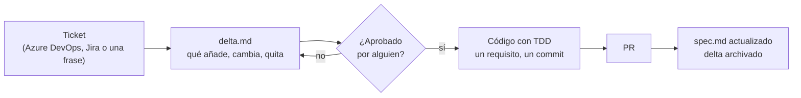

# Sdd-Developer-setup

Una forma sencilla de trabajar con Claude Code en la que **primero se escribe qué va a cambiar y después el código**. Cada funcionalidad tiene una hoja de requisitos (`spec.md`); cada cambio, una nota con lo que añade, modifica o quita (`delta.md`); una persona la aprueba, y solo entonces se programa. Un comando, `/sdd`, lleva el cambio de principio a fin. Vale para cualquier lenguaje: C#, TypeScript y Python vienen preparados; los demás los añade cada equipo con un responsable.

Esta guía es para **usarlo**. Las secciones marcadas "(developers)" piden conocer el repo y la terminal; el resto lo puede leer cualquiera. Si quieres saber cómo está construido o cambiarlo, lee [`docs/IMPLEMENTACION.md`](docs/IMPLEMENTACION.md). Las palabras del flujo están en el [glosario](#glosario) del final.

- [Qué resuelve](#qué-resuelve)
- [Si no eres developer](#si-no-eres-developer)
- [Qué skills hay](#qué-skills-hay)
- [Quién hace qué](#quién-hace-qué)
- [Instalar en dos minutos](#instalar-en-dos-minutos)
- [Preparar un repo (developers)](#preparar-un-repo-developers)
- [Lenguajes: los tres incluidos y los tuyos (developers)](#lenguajes-los-tres-incluidos-y-los-tuyos-developers)
- [Conectar el gestor de tareas (developers)](#conectar-el-gestor-de-tareas-developers)
- [Trabajar un cambio, paso a paso](#trabajar-un-cambio-paso-a-paso)
- [Principios que valen para cualquier lenguaje](#principios-que-valen-para-cualquier-lenguaje)
- [Cuando no hace falta delta](#cuando-no-hace-falta-delta)
- [Encontrar lo que ya existe](#encontrar-lo-que-ya-existe)
- [Elegir el modelo en cada fase](#elegir-el-modelo-en-cada-fase)
- [Ejemplo completo](#ejemplo-completo)
- [Varios servicios, una funcionalidad (developers)](#varios-servicios-una-funcionalidad-developers)
- [Proyectos legacy (developers)](#proyectos-legacy-developers)
- [Skills de librerías (developers)](#skills-de-librerías-developers)
- [Preguntas frecuentes](#preguntas-frecuentes)
- [Glosario](#glosario)

## Qué resuelve

Sin esto, el agente recibe "implementa el PBI 1234" y empieza a escribir código con lo que entiende del ticket. Lo que se pide, lo que entiende y lo que acaba en el código se parecen, pero nadie lo ha comprobado antes de gastar el tiempo.

Con esto:

1. **El agente escribe primero el delta**: tres listas (requisitos que añade, que cambia, que quita), cada requisito en una frase `GIVEN / WHEN / THEN` que se puede convertir en un test.
2. **Una persona lo lee y lo aprueba**, poniendo su nombre. Son diez líneas, no un diff de treinta ficheros.
3. **El agente implementa solo eso**, requisito a requisito, con el test antes que el código y el id del requisito en cada commit.
4. **Al cerrar, el spec de la funcionalidad absorbe el delta.** El spec describe siempre lo que hay en `main`; el historial dice quién cambió qué y cuándo.



## Si no eres developer

Puedes pedir un cambio sin saber de código. Lo que necesitas saber cabe aquí:

1. **Pide el cambio en una frase**, como se lo contarías a una compañera: `/sdd 1250 que el correo de bienvenida salude por el nombre`. Si hay un ticket, pon su número; si no, cualquier número que el equipo no use.
2. **El agente te dice de qué tipo es** antes de hacer nada: "autoservicio" (lo puede cerrar cualquiera del equipo), "cambio de requisitos" (un developer tiene que aprobar diez líneas) o "riesgo" (un developer tiene que mirarlo con calma). No frena nada; solo dice quién tiene que intervenir.
3. **Si escribe un delta, léelo.** Está en lenguaje de negocio: cada requisito es "dado esto, cuando pasa esto, entonces ocurre esto". Si algo no es lo que querías, díselo y lo reescribe. Es barato cambiarlo ahora y caro después.
4. **Alguien lo aprueba** poniendo su nombre en el delta. Quién puede aprobar lo decide cada equipo; normalmente un developer, pero no tiene por qué ser quien lo pidió.
5. **El agente programa y abre una PR.** Si el cambio era de autoservicio, la PR se marca con la etiqueta `self-service` y la puede revisar cualquiera del equipo, tú incluida. Si no, la revisa un developer.
6. **Cuando se cierra, el spec queda actualizado**: la hoja de requisitos de esa funcionalidad dice lo que hace el sistema hoy. Si quieres saber cómo funciona algo, pregúntale al agente por el requisito o lee el spec; no hace falta leer código.

Lo que no pasará nunca: que algo llegue al producto sin que una persona lo haya revisado. El autoservicio ahorra el tiempo del developer en lo que no lo necesita; no quita la revisión.

## Qué skills hay

Una skill es un comando que Claude Code aprende al instalar el plugin; se invoca escribiéndolo o el agente la elige solo cuando lo que pides encaja con su descripción.

| Skill | Para qué | Cuándo la usas |
|---|---|---|
| `/sdd <id> [descripción]` | Llevar un cambio de principio a fin: escribe el delta, se detiene hasta que alguien lo aprueba, implementa con tests, revisa si se lo pides, fusiona en el spec al cerrar. Decide él en qué paso está por el estado del delta | Siempre que empieces, sigas, revises o cierres un PBI, bug o tarea |
| `/sdd-models` | Ver, recomendar o cambiar qué nivel de modelo usa cada fase, guardado en `sdd.json` | Cuando salen modelos nuevos o algo sale caro o flojo |
| `/sdd-languages` | Ver, activar o añadir paquetes de lenguaje (cómo se cita un requisito en un test, comandos, carpetas a ignorar); C#, TypeScript y Python vienen incluidos, los demás los añade el equipo con un responsable | Al preparar un repo o al incorporar un lenguaje |
| `masstransit-saga` (plugin `libraries`, opcional) | Cómo montar y probar una saga con MassTransit, con las trampas aprendidas | Al tocar una saga; se activa sola |

La definición completa de cada una (qué hace, qué no hace, con qué modelo, y cómo se cambia) está en [`docs/SKILLS.md`](docs/SKILLS.md).

## Quién hace qué

Cualquier persona puede pedir un cambio: producto, soporte, negocio, QA. No hace falta saber de código, porque el delta se escribe en lenguaje de negocio y el agente clasifica cuánta intervención técnica hace falta, y lo dice antes de empezar:

| Nivel | Qué es | Quién interviene | Ejemplo |
|---|---|---|---|
| **0, autoservicio** | No cambia ningún requisito y solo toca lo que el equipo ha abierto en `selfService` (textos, traducciones, documentación, valores de configuración acotados) | Nadie de desarrollo. El agente implementa, el CI pasa, una persona pone la etiqueta `self-service` a la PR y la revisa cualquiera del equipo. Si el agente tuvo que tocar algo fuera de esas rutas, lo dice y deja de ser nivel 0 | Producto cambia el texto del correo de bienvenida |
| **1, cambio de requisitos** | Añade, modifica o quita requisitos, sin tocar contratos, esquema de datos ni permisos | Un developer aprueba el delta (diez líneas, cinco minutos, su nombre en `approved_by`) y revisa la PR; el agente hace el resto | Producto pide limitar los intentos de confirmación |
| **2, riesgo** | Toca mensajes entre servicios, el esquema de datos (una migración, una tabla, una columna), autorización, pagos o datos personales, o muchos requisitos a la vez | Developer en el delta y en la PR, revisión con el nivel máximo de modelo | Cambiar qué evento se publica al activar un usuario |

Lo que no cambia nunca: nada llega a `main` sin una PR que pase el CI y que una persona revise. El autoservicio ahorra el tiempo del developer en lo que no lo necesita; no quita la revisión, cambia quién la hace. Las rutas de autoservicio las decide cada equipo en `sdd.json` y están vacías por defecto. El agente nunca aprueba: `approved` y `approved_by` los escribe una persona.

El texto de los requisitos está pensado para que lo lea quien lo pidió: GIVEN/WHEN/THEN en lenguaje de negocio, sin nombres de clases ni tablas. Lo técnico va en el plan, que es para el agente y el developer.

## Instalar en dos minutos

Necesitas Claude Code, git y Python 3 (`python` en Windows, `python3` en macOS y Linux).

```powershell
git clone https://github.com/goguiGit/Sdd-Developer-setup
powershell -ExecutionPolicy Bypass -File .\Sdd-Developer-setup\setup\install.ps1
```

```bash
git clone https://github.com/goguiGit/Sdd-Developer-setup
./Sdd-Developer-setup/setup/install.sh
```

Esto instala el plugin `sdd` en tu Claude Code y deja programada una **actualización diaria a las 08:00** para que siempre tengas la última versión (cambia la hora con `-UpdateAt 09:30` o `UPDATE_AT=09:30`; quítala con `-RemoveSchedule` o `--remove-schedule`). No hace falta volver a ejecutarlo. En Windows, `-ExecutionPolicy Bypass` solo afecta a esa ejecución; si tu política ya permite scripts locales, basta con `.\setup\install.ps1`.

Comprueba que funciona: reinicia Claude Code si lo tenías abierto, ábrelo en cualquier carpeta y escribe `/sdd`. Debe reconocer el comando.

## Preparar un repo (developers)

Una vez por repositorio:

```powershell
.\Sdd-Developer-setup\setup\install.ps1 -Repo C:\src\MiServicio
```

Deja en el repo `AGENTS.md` (orientación para el agente: qué es el sistema, límites, cómo verificar; rellena los `<...>`), `CLAUDE.md` (una línea que importa el anterior), `sdd.json` (configuración del flujo) y la carpeta `docs/features/` con sus índices ya generados. Después, dentro de Claude Code en ese repo, activa los lenguajes que use: `/sdd-languages use csharp`, `/sdd-languages use typescript`. Añade el check de CI copiando esto en `.github/workflows/sdd-checks.yml`:

```yaml
name: sdd-checks
on: [pull_request]
jobs:
  sdd:
    uses: goguiGit/Sdd-Developer-setup/.github/workflows/sdd-checks.yml@main
```

Desde ese momento, una PR con un delta mal formado, que no encaja con su spec o con los índices sin regenerar falla. Una PR sin delta pasa. Si prefieres que el CI no cambie sin que lo decidas, sustituye `@main` por una etiqueta de versión (`@v0.5.0`).

## Lenguajes: los tres incluidos y los tuyos (developers)

El flujo es el mismo en cualquier lenguaje; lo que cambia (qué extensiones son código, qué carpetas generadas hay que ignorar, cómo se cita un requisito en un test, qué comandos compilan y prueban, cómo se ven los principios rotos en ese ecosistema) vive en un **paquete de lenguaje**: un fichero Markdown con una cabecera de datos.

| Lenguaje | Dónde está | Quién lo mantiene |
|---|---|---|
| C# / .NET | Dentro del plugin | Este repo (soporte de primera) |
| TypeScript / JavaScript | Dentro del plugin | Este repo (soporte de primera) |
| Python | Dentro del plugin | Este repo |
| Cualquier otro (Go, Java, Kotlin, Rust, SQL…) | `docs/sdd/languages/<lang>.md` en el repo del producto | **Obligatorio** un `owner`: la persona o equipo que responde de él |

`/sdd-languages list` enseña los disponibles; `use <lang>` activa uno en `sdd.json` y rellena la sección "Reglas del lenguaje" de `AGENTS.md`; `add go --owner equipo-plataforma` crea uno nuevo desde la plantilla, y **sin `--owner` se niega**. Es la única rigidez a propósito: cualquiera puede traer un lenguaje, pero nadie puede traerlo sin hacerse cargo. Si un lenguaje de uso general se queda bien definido en un repo, se propone a este marketplace con una PR y pasa a ser de primera.

El script usa los paquetes activos para saber qué ficheros mirar al buscar quién nombra un requisito (`where`, `coverage`); sin ninguno activo mira una lista amplia que cubre los ecosistemas habituales, más lenta en repos grandes.

## Conectar el gestor de tareas (developers)

Opcional, pero es lo que permite que el agente **lea el ticket**, **cree las tareas** del plan y **cierre el ticket** al fusionar. Se hace una vez por máquina, registrando el MCP correspondiente en Claude Code:

| Gestor | Comando | Qué necesita |
|---|---|---|
| Azure DevOps | `.\setup\install.ps1 -Tracker AzureDevOps -Organization miorg` (o `claude mcp add --scope user azure-devops -- npx -y @azure-devops/mcp miorg`) | Sesión de `az login` con acceso a la organización |
| Jira | `.\setup\install.ps1 -Tracker Jira` (o `claude mcp add --transport sse --scope user atlassian https://mcp.atlassian.com/v1/sse`) | Inicia sesión en el navegador la primera vez que Claude lo usa |

Qué hace el agente con el gestor en cada fase:

- **Al crear el delta**: lee título, descripción y criterios de aceptación del ticket, lo pasa a "en curso" y se lo asigna.
- **Al empezar a implementar** (delta aprobado): si se lo pides, crea una tarea hija por cada casilla del plan, enlazada al ticket, y las va cerrando al completar cada una. Nunca antes de la aprobación: un delta en borrador puede cambiar entero.
- **Al fusionar**: copia los `GIVEN / WHEN / THEN` a los criterios de aceptación del ticket y lo cierra, si se lo pides y la PR ya está mergeada.

Sin gestor conectado todo sigue funcionando: el agente te pregunta lo imprescindible y te dice qué cerrar a mano. Avisar por Teams o Slack no forma parte del flujo; si quieres un aviso, se lo pides explícitamente con el MCP que tengas. Detalle en [`trackers.md`](plugins/sdd/skills/sdd/references/trackers.md).

## Trabajar un cambio, paso a paso

Supongamos el PBI 1234, "límite de intentos al confirmar el email", en el servicio de registro.

**1. Pide el delta.** En Claude Code, dentro del repo:

```
/sdd 1234 límite de intentos al confirmar el email
```

El agente lee el ticket si tienes el gestor conectado (si no, te pregunta lo imprescindible una vez), busca la funcionalidad en `docs/features/`, y escribe `docs/features/registro-usuario/changes/1234-limite-intentos/delta.md`:

```markdown
---
pbi: 1234
title: Límite de intentos de confirmación
feature: registro-usuario
status: draft
---
## Por qué
Un código de seis dígitos con 24 horas de plazo admite fuerza bruta.

## ADDED
### REQ-REG-006 Límite de intentos fallidos
GIVEN un usuario pendiente que ya ha enviado cuatro códigos incorrectos
WHEN envía un quinto código incorrecto
THEN el registro se descarta y se avisa a la persona

## MODIFIED
### REQ-REG-003 Código incorrecto
GIVEN un usuario pendiente con menos de cuatro intentos fallidos
WHEN confirma con un código distinto al que recibió
THEN el usuario sigue pendiente, se cuenta el intento y puede volver a intentarlo

## REMOVED

## Plan
- [ ] Test: el quinto código incorrecto descarta el registro
- [ ] Test: el cuarto deja el registro pendiente con 4 intentos
```

Crea la rama `feature/1234-limite-intentos` y hace un commit solo con el delta y los índices regenerados. **No escribe código.**

**2. Aprueba.** Lee el delta. Si estás de acuerdo, cambia `status: draft` por `status: approved` y añade `approved_by: <tu nombre>` (o, si tu equipo prefiere que quede constancia, abre una PR solo con el delta y que la apruebe quien corresponda). Si no, díselo al agente y lo corrige. El agente nunca escribe esas dos líneas.

**3. Implementa.**

```
/sdd 1234
```

Con el delta en `approved`, el agente crea las tareas en el gestor si se lo pides (una por casilla del plan) y delega la implementación en un subagente del nivel configurado para implementar, que va requisito a requisito: escribe el test que demuestra el `GIVEN / WHEN / THEN` (citando el requisito como diga el paquete de lenguaje), lo ve fallar, escribe el código mínimo, y hace un commit `feat: límite de intentos (REQ-REG-006)`. No toca el `spec.md` ni implementa nada que no esté en el delta; si descubre que falta algo, te lo dice en vez de colarlo. Al terminar pone `status: implemented`, regenera los índices y lo commitea.

**4. Abre la PR.** El CI valida el delta y los índices. El revisor tiene una [tabla de ocho comprobaciones](plugins/sdd/skills/sdd/references/review-checklist.md): cada requisito con su test, nada fuera del delta, el spec intacto. Si quieres que el agente revise antes, `/sdd review 1234`: lo hace con el nivel máximo y te devuelve hallazgos, no cambios.

**5. Cierra.** Tras el merge:

```
/sdd 1234
```

El agente fusiona el delta en `spec.md` (REQ-REG-006 aparece, REQ-REG-003 queda con el texto nuevo, el historial gana una fila) y archiva la carpeta del cambio. Si se lo pides, copia los requisitos a los criterios de aceptación del ticket y lo cierra.

En resumen: `/sdd <id>` siempre hace lo que toca según el estado del delta. No hay que recordar más comandos.

## Principios que valen para cualquier lenguaje

Cada repo tiene las reglas de su lenguaje en su paquete de lenguaje y en su `AGENTS.md` (formato, convenciones de nombres, librerías); las convenciones del flujo (cómo se llaman features, requisitos, ramas, commits, tests y mensajes) están en la sección "Nombres" de [`format.md`](plugins/sdd/skills/sdd/references/format.md#nombres) y valen para todos los repos. Lo que el flujo exige igual en cualquier lenguaje está en [`principles.md`](plugins/sdd/skills/sdd/references/principles.md): SOLID, lo mínimo que cumple el requisito, sin duplicar conocimiento, errores explícitos, límites claros entre capas y servicios, nombres que hacen innecesario el comentario, tests que prueban el requisito e idempotencia en los consumidores de mensajes. Cada principio va con la **señal** de que se está rompiendo, escrita sin nombres de librerías; cada paquete de lenguaje la traduce a lo que se ve en su ecosistema. El agente lo tiene a mano al refactorizar en verde y el revisor en la fila "Diseño" del checklist.

## Cuando no hace falta delta

Si el cambio **no añade, modifica ni quita ningún requisito** (un bug dentro de un comportamiento ya descrito, un refactor, deuda técnica, un texto), no hay delta: el agente implementa con TDD y cita el requisito existente en el commit. Si además solo toca rutas de `selfService`, es nivel 0 y no necesita developer. La prueba es sencilla: si después del cambio todas las frases `GIVEN / WHEN / THEN` del spec siguen siendo ciertas y no hace falta ninguna nueva, no es un delta.

## Encontrar lo que ya existe

Con veinte funcionalidades y doscientos requisitos nadie, ni el agente, debe leer todos los specs para saber qué hay. El script mantiene tres índices generados en `docs/features/`, y el agente empieza siempre por ellos:

| Fichero | Qué contiene | Para qué |
|---|---|---|
| `INDEX.md` | Una línea por funcionalidad (título, nº de requisitos, deltas abiertos, último cambio) y la lista de deltas abiertos con su estado | Saber qué existe y qué está en curso en una pantalla |
| `REQ-INDEX.md` | Una línea por requisito activo: id, título, funcionalidad | Encontrar el requisito que toca sin abrir specs |
| `CONTRACTS.md` | Qué mensajes publica y consume cada requisito (líneas `Publica:` / `Consume:` del spec) | Saber quién emite y quién escucha cada evento entre servicios |

Se regeneran en cada commit que toca `docs/features/` (el agente lo hace; `merge` también), y el CI falla si alguien los deja desactualizados. Para seguir un requisito concreto hasta el final, pídeselo al agente ("dónde está REQ-REG-003") o, con este repo clonado:

```
python3 <ruta-al-clon>/plugins/sdd/scripts/sdd.py where REQ-REG-003
python3 <ruta-al-clon>/plugins/sdd/scripts/sdd.py coverage
```

`where` devuelve su texto en el spec, los deltas que lo tocaron (abiertos y archivados), los ficheros de código y tests que lo nombran y los commits que lo citan. `coverage` lista los requisitos que ningún fichero nombra: los que no tienen test. Es la trazabilidad completa en una pantalla, sin herramientas externas: la dan los ids estables y la convención de ponerlos en tests y commits.

¿Y un grafo de conocimiento (Graphify y similares)? Lo evaluaremos cuando aparezcan preguntas que los índices y `where` no respondan bien, como "si cambio este requisito, qué servicios se ven afectados" a través de muchos repos; el criterio está en [`docs/decisiones.md`](docs/decisiones.md).

## Elegir el modelo en cada fase

Los modelos cambian de nombre y de capacidad cada pocos meses, así que el flujo habla de **niveles**, no de modelos: máximo, medio y rápido, con los alias que Claude Code resuelve siempre al modelo actual de cada nivel (`opus`, `sonnet`, `haiku`). Nunca un id con fecha.

| Fase | Nivel por defecto | Por qué |
|---|---|---|
| Escribir el delta | Máximo | Es donde se decide qué se construye |
| Implementar | Medio | Trabajo acotado por un delta aprobado y por tests |
| Revisar | Máximo | Hay que encontrar lo que falta |
| Fusionar, índices, cerrar el ticket | Rápido | Es ejecutar el script y leer su salida |

El agente aplica la tabla al **delegar** implementar y revisar a un subagente; escribir el delta y fusionar los hace en la sesión y, si el nivel de la sesión no es el de la tabla, lo dice. **Sube o baja de nivel por su cuenta** con criterios escritos: sube al máximo si el delta toca más de tres requisitos, un contrato entre servicios, el esquema de datos o la autorización, o si un requisito falla sus tests dos veces seguidas; baja al rápido en documentación, índices y cambios triviales. Siempre dice en el resumen qué nivel usó y por qué, también cuando no pudo aplicar la tabla, para que el equipo pueda corregirla.

El equipo lo ajusta con `sdd.json` en la raíz del repo (lo deja el instalador; plantilla en `plugins/sdd/templates/sdd.json`):

```json
{
  "models": { "change": "opus", "impl": "sonnet", "review": "opus", "merge": "haiku" },
  "tracker": "AzureDevOps",
  "createTasks": true,
  "selfService": ["docs/**", "**/locales/**/*.json"],
  "languages": ["csharp", "typescript"]
}
```

`createTasks` decide si al pasar a implementar se crean las tareas hijas del plan en el gestor sin preguntar (`true`), preguntando (`false`) o nunca (`"never"`); `selfService` son las rutas de autoservicio; `languages`, los paquetes de lenguaje activos. Detalle y criterios en [`models.md`](plugins/sdd/skills/sdd/references/models.md).

Para no editar el JSON a mano hay una segunda skill, `/sdd-models`: `show` enseña la tabla actual, `recommend` compara los alias del fichero con los modelos que ofrece Claude Code hoy y propone cambios (un alias que ya no existe, un nivel nuevo que encaja mejor, una fase que viene fallando), `set impl sonnet` cambia una fase y hace su commit, `reset` vuelve a los valores por defecto. Cuando salga una generación nueva de modelos, `/sdd-models recommend` es el único paso.

## Ejemplo completo

[`examples/happy-path/`](examples/happy-path/README.md) abre con el **árbol de decisiones** que el agente recorre en cada `/sdd` (dónde se detiene, cuándo hace falta un developer, qué modelo trabaja en cada tramo) y narra un PBI de principio a fin sobre el servicio de registro: qué escribe la persona, qué hace el agente en cada paso, qué ficheros cambian, las cuatro tareas que crea en Azure DevOps y las cierra al implementar, el modelo que usa en cada fase y cómo queda todo al fusionar. Incluye un segundo camino pedido por Producto sin developer, y las variantes sin gestor, sin cambio de requisitos y con el ticket cambiando a mitad.

## Varios servicios, una funcionalidad (developers)

En un ecosistema de microservicios una funcionalidad suele tocar dos o tres repos. Reglas:

- **Cada repo tiene su `docs/features/`** y sus specs. No hay un spec central: el spec de un servicio describe lo que ese servicio hace, incluidos los **mensajes que publica** (línea `Publica: UserActivated` en el requisito). El servicio que consume tiene su propio requisito con `Consume: UserActivated`. `CONTRACTS.md` de cada repo lista ambos lados; entre repos, la búsqueda de código de GitHub por el nombre del mensaje o del requisito es el índice.
- **El mismo PBI, un delta por repo.** Los deltas comparten `pbi` y se aprueban por separado; cada uno lo revisa quien conoce ese servicio. El trailer `Refs: PBI-1234` en los commits de todos los repos permite reconstruir el cambio completo desde el gestor.
- **El área del requisito es el contexto, no el repo**: `REG` para registro aunque mañana se parta en dos servicios; así los ids no cambian al reorganizar.
- **Librerías compartidas** también llevan spec: lo que exponen son requisitos de la librería, y una versión nueva es un delta. El servicio que la adopta no repite esos requisitos; los referencia.
- **Repos con varios lenguajes** (una API y su frontend, por ejemplo) activan varios paquetes en `languages`; el script une sus extensiones y carpetas.
- El plugin y el CI son los mismos para todos los repos; nada se copia de un repo a otro. Cuando el flujo cambia, cambia en este repo y cada developer lo recibe en la actualización de las 08:00.

## Proyectos legacy (developers)

Un sistema de años no tiene spec y no se va a escribir entero. Tampoco hace falta:

- **Spec de rescate, solo de lo que tocas.** La primera vez que un cambio toca una zona sin spec, el agente crea `docs/features/<zona>/spec.md` con los requisitos que describen **el comportamiento actual relevante para ese cambio** (tres o cuatro frases `GIVEN / WHEN / THEN`, fila "Spec inicial" en el historial) y, encima, el delta con lo que cambia. Lo que no se toca sigue sin spec; el código es la verdad hasta que alguien lo necesite.
- **La vía rápida es la normal al principio.** La mayoría de cambios en legacy son bugs dentro de comportamientos existentes: se implementan citando el requisito, o sin requisito si todavía no existe.
- **Un área por módulo que se entienda**, no por carpeta del código: `NOM` para nómina, `FICH` para fichajes. Que el nombre sobreviva a la próxima reorganización.
- **No se exige TDD retroactivo**: el test que acompaña a cada requisito nuevo es el primero de esa zona; con el tiempo la cobertura crece donde hay cambios, que es donde importa. `coverage` enseña cuánto falta.
- El CI en modo `enforce: true` también vale en legacy, porque una PR sin delta pasa; solo exige que, cuando hay delta, esté bien.

## Skills de librerías (developers)

Además del flujo, el mismo marketplace reparte un **catálogo de skills de uso de librerías**, una por librería y stack (cómo se usa la caché, la mensajería, los feature flags… en .NET, en Node, en Python): el plugin `libraries`, que el agente carga cuando toca esa librería. Se instala aparte, solo quien lo necesita:

```
claude plugin install libraries@sdd-developer-setup
```

Y la misma tarea diaria lo mantiene al día. Cómo se añade una está en [`docs/IMPLEMENTACION.md`](docs/IMPLEMENTACION.md#añadir-una-skill-de-librería). La primera, `masstransit-saga`, resume cómo montar una saga con MassTransit a partir de [MassTransit.Saga.Demo](https://github.com/goguiGit/MassTransit.Saga.Demo).

## Preguntas frecuentes

**¿Quién aprueba?** Quien el equipo decida; por defecto, cualquiera que no sea quien pidió el cambio. Pone su nombre en `approved_by`. Si la aprobación debe quedar registrada, el delta se mergea en su propia PR y CODEOWNERS limita quién la aprueba.

**¿Y si el ticket cambia a mitad?** El delta vuelve a `draft`, se modifica, se vuelve a aprobar. El agente no implementa requisitos que no estén en un delta aprobado.

**¿Qué pasa si el spec y el código no coinciden?** El código manda sobre el comportamiento, el spec sobre lo acordado. Cuando se detecta, es un delta: o se corrige el código (el spec tenía razón) o se corrige el spec (el código tenía razón y nadie lo había escrito).

**¿Funciona sin Azure DevOps ni Jira?** Sí. El id puede ser cualquier número o clave; el agente te pregunta lo que necesita si no puede leer el ticket.

**Mi lenguaje no está entre los tres. ¿Puedo usarlo?** Sí: `/sdd-languages add <lang> --owner <quién>` crea el paquete en tu repo desde la plantilla. Lo único innegociable es el `owner`.

**¿Funciona con Codex o Copilot?** El `AGENTS.md` del repo lo leen los tres. La skill `/sdd` es de Claude Code; en otros agentes se puede seguir el mismo ciclo a mano con `sdd.py`.

**¿Dónde veo qué cambió una funcionalidad con el tiempo?** En `## Historial` de su `spec.md` y en `changes/archive/`, donde quedan todos los deltas fusionados con su fecha.

## Glosario

| Palabra | Qué es |
|---|---|
| **Feature** (funcionalidad) | Una capacidad del producto con nombre de negocio: "registro de usuario", "aprobación de vacaciones". Tiene una carpeta en `docs/features/` |
| **Spec** | La hoja de requisitos de una feature (`spec.md`). Describe lo que el sistema hace hoy, en `main` |
| **Requisito** (REQ) | Una frase "GIVEN / WHEN / THEN" (dado, cuando, entonces) con un id estable, `REQ-REG-006`. Cada requisito tiene al menos un test que lo nombra |
| **Delta** | La nota de un cambio (`delta.md`): por qué, qué requisitos añade, modifica y quita, y el plan. Es lo que se aprueba |
| **Aprobar** | Una persona pone `status: approved` y su nombre en `approved_by`. Hasta entonces no hay código |
| **Fusionar** | Al cerrar, el delta se aplica al spec, se archiva con su fecha y los índices se regeneran |
| **Índices** | Tres ficheros generados en `docs/features/`: qué features hay, qué requisitos hay y qué mensajes se intercambian. Para orientarse sin leerlo todo |
| **Nivel de intervención** | Cuánta gente técnica hace falta: 0 autoservicio (nadie de desarrollo), 1 un developer aprueba, 2 riesgo |
| **Autoservicio** | Un cambio sin requisitos nuevos que solo toca rutas abiertas por el equipo (`selfService`). La PR lleva la etiqueta `self-service`, puesta por una persona |
| **Paquete de lenguaje** | Lo que el flujo necesita saber de un lenguaje: extensiones, carpetas a ignorar, cómo se cita un requisito en un test, comandos. Tres incluidos; los demás con `owner` |
| **Gestor de tareas** | Azure DevOps o Jira. El agente lee el ticket, crea tareas y lo cierra a través de un MCP |
| **MCP** | Conector que permite a Claude Code hablar con otra herramienta (el gestor de tareas). Se registra una vez por máquina |
| **Skill** | Un comando que Claude Code aprende con el plugin (`/sdd`, `/sdd-models`, `/sdd-languages`) |
| **Plugin / marketplace** | El paquete que instala las skills y el catálogo que lo distribuye. La actualización diaria trae la última versión |
| **Nivel de modelo** | Máximo, medio o rápido (`opus`, `sonnet`, `haiku`): qué tan capaz y caro es el modelo que trabaja en cada fase |
| **PR** (pull request) | La propuesta de cambio que una persona revisa antes de que llegue a `main` |
| **CI** | Las comprobaciones automáticas de cada PR: deltas bien formados, índices al día, tests |
| **TDD** | Escribir el test antes que el código: se ve fallar, se implementa lo mínimo, se ve pasar |
