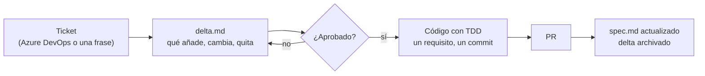

# Sdd-Developer-setup

Una forma sencilla de trabajar con Claude Code en la que **primero se escribe qué va a cambiar y después el código**. Cada funcionalidad tiene una hoja de requisitos (`spec.md`); cada cambio, una nota con lo que añade, modifica o quita (`delta.md`); alguien la aprueba, y solo entonces se programa. Un comando, `/sdd`, lleva el cambio de principio a fin.

Esta guía es para **usarlo**. Si quieres saber cómo está construido o cambiarlo, lee [`docs/IMPLEMENTACION.md`](docs/IMPLEMENTACION.md).

- [Qué resuelve](#qué-resuelve)
- [Instalar en dos minutos](#instalar-en-dos-minutos)
- [Preparar un repo](#preparar-un-repo)
- [Conectar el gestor de tareas](#conectar-el-gestor-de-tareas)
- [Trabajar un cambio, paso a paso](#trabajar-un-cambio-paso-a-paso)
- [Cuando no hace falta delta](#cuando-no-hace-falta-delta)
- [Encontrar lo que ya existe](#encontrar-lo-que-ya-existe)
- [Varios servicios, una funcionalidad](#varios-servicios-una-funcionalidad)
- [Proyectos legacy](#proyectos-legacy)
- [Skills de librerías](#skills-de-librerías)
- [Preguntas frecuentes](#preguntas-frecuentes)

## Qué resuelve

Sin esto, el agente recibe "implementa el PBI 1234" y empieza a escribir código con lo que entiende del ticket. Lo que se pide, lo que entiende y lo que acaba en el código se parecen, pero nadie lo ha comprobado antes de gastar el tiempo.

Con esto:

1. **El agente escribe primero el delta**: tres listas (requisitos que añade, que cambia, que quita), cada requisito en una frase `GIVEN / WHEN / THEN` que se puede convertir en un test.
2. **Una persona lo lee y lo aprueba.** Son diez líneas, no un diff de treinta ficheros.
3. **El agente implementa solo eso**, requisito a requisito, con el test antes que el código y el id del requisito en cada commit.
4. **Al cerrar, el spec de la funcionalidad absorbe el delta.** El spec describe siempre lo que hay en `main`; el historial dice quién cambió qué y cuándo.



## Instalar en dos minutos

Necesitas Claude Code, git y Python 3.

```powershell
git clone https://github.com/goguiGit/Sdd-Developer-setup
.\Sdd-Developer-setup\setup\install.ps1
```

```bash
git clone https://github.com/goguiGit/Sdd-Developer-setup
./Sdd-Developer-setup/setup/install.sh
```

Esto instala el plugin `sdd` en tu Claude Code y deja programada una **actualización diaria a las 08:00** para que siempre tengas la última versión (cambia la hora con `-UpdateAt 09:30` o `UPDATE_AT=09:30`; quítala con `-RemoveSchedule` o `--remove-schedule`). No hace falta volver a ejecutarlo.

Comprueba que funciona: abre Claude Code en cualquier carpeta y escribe `/sdd`. Debe reconocer el comando.

## Preparar un repo

Una vez por repositorio:

```powershell
.\Sdd-Developer-setup\setup\install.ps1 -Repo C:\src\MiServicio
```

Deja en el repo `AGENTS.md` (orientación para el agente: qué es el sistema, límites, cómo verificar; rellena los `<...>`), `CLAUDE.md` (una línea que importa el anterior) y la carpeta `docs/features/`. Añade el check de CI copiando esto en `.github/workflows/sdd-checks.yml`:

```yaml
name: sdd-checks
on: [pull_request]
jobs:
  sdd:
    uses: goguiGit/Sdd-Developer-setup/.github/workflows/sdd-checks.yml@main
```

Desde ese momento, una PR con un delta mal formado o que no encaja con su spec falla. Una PR sin delta pasa.

## Conectar el gestor de tareas

Opcional, pero es lo que permite que el agente **lea el ticket**, **cree las tareas** del plan y **cierre el ticket** al fusionar. Se hace una vez por máquina, registrando el MCP correspondiente en Claude Code:

| Gestor | Comando | Qué necesita |
|---|---|---|
| Azure DevOps | `.\setup\install.ps1 -Tracker AzureDevOps -Organization miorg` (o `claude mcp add --scope user azure-devops -- npx -y @azure-devops/mcp miorg`) | Sesión de `az login` con acceso a la organización |
| Jira | `.\setup\install.ps1 -Tracker Jira` (o `claude mcp add --transport sse --scope user atlassian https://mcp.atlassian.com/v1/sse`) | Inicia sesión en el navegador la primera vez que Claude lo usa |

Qué hace el agente con el gestor en cada fase:

- **Al crear el delta**: lee título, descripción y criterios de aceptación del ticket, lo pasa a "en curso" y se lo asigna.
- **Al empezar a implementar** (delta aprobado): si se lo pides, crea una tarea hija por cada casilla del plan, enlazada al ticket, y las va cerrando al completar cada una. Nunca antes de la aprobación: un delta en borrador puede cambiar entero.
- **Al fusionar**: copia los `GIVEN / WHEN / THEN` a los criterios de aceptación del ticket y lo cierra, si se lo pides y la PR ya está mergeada.

Sin gestor conectado todo sigue funcionando: el agente te pregunta lo imprescindible y te dice qué cerrar a mano. Avisar por Teams o Slack no forma parte del flujo; si quieres un aviso, se lo pides explícitamente con el MCP que tengas. Detalle en [`trackers.md`](plugins/sdd/skills/sdd/references/trackers.md).

## Trabajar un cambio, paso a paso

Supongamos el PBI 1234, "límite de intentos al confirmar el email", en el servicio de registro.

**1. Pide el delta.** En Claude Code, dentro del repo:

```
/sdd 1234 límite de intentos al confirmar el email
```

El agente lee el ticket si tienes el gestor conectado (si no, te pregunta lo imprescindible una vez), busca la funcionalidad en `docs/features/`, y escribe `docs/features/registro-usuario/changes/1234-limite-intentos/delta.md`:

```markdown
---
pbi: 1234
title: Límite de intentos de confirmación
feature: registro-usuario
status: draft
---
## Por qué
Un código de seis dígitos con 24 horas de plazo admite fuerza bruta.

## ADDED
### REQ-REG-006 Límite de intentos fallidos
GIVEN un usuario pendiente que ya ha enviado cuatro códigos incorrectos
WHEN envía un quinto código incorrecto
THEN el registro se descarta y se avisa a la persona

## MODIFIED
### REQ-REG-003 Código incorrecto
GIVEN un usuario pendiente con menos de cuatro intentos fallidos
WHEN confirma con un código distinto al que recibió
THEN el usuario sigue pendiente, se cuenta el intento y puede volver a intentarlo

## REMOVED

## Plan
- [ ] Test: el quinto código incorrecto descarta el registro
- [ ] Test: el cuarto deja el registro pendiente con 4 intentos
```

Crea la rama `feature/1234-limite-intentos` y hace un commit solo con el delta. **No escribe código.**

**2. Aprueba.** Lee el delta. Si estás de acuerdo, cambia `status: draft` por `status: approved` (o, si tu equipo prefiere que quede constancia, abre una PR solo con el delta y que la apruebe quien corresponda). Si no, díselo al agente y lo corrige.

**3. Implementa.**

```
/sdd 1234
```

Con el delta en `approved`, el agente crea las tareas en el gestor si se lo pides (una por casilla del plan) y va requisito a requisito: escribe el test que demuestra el `GIVEN / WHEN / THEN`, lo ve fallar, escribe el código mínimo, y hace un commit `feat: límite de intentos (REQ-REG-006)`. No toca el `spec.md` ni implementa nada que no esté en el delta; si descubre que falta algo, te lo dice en vez de colarlo. Al terminar pone `status: implemented`.

**4. Abre la PR.** El CI valida el delta. El revisor tiene una [tabla de siete comprobaciones](plugins/sdd/skills/sdd/references/review-checklist.md): cada requisito con su test, nada fuera del delta, el spec intacto.

**5. Cierra.** Tras el merge:

```
/sdd 1234
```

El agente fusiona el delta en `spec.md` (REQ-REG-006 aparece, REQ-REG-003 queda con el texto nuevo, el historial gana una fila) y archiva la carpeta del cambio. Si se lo pides, copia los requisitos a los criterios de aceptación del ticket y lo cierra.

En resumen: `/sdd <id>` siempre hace lo que toca según el estado del delta. No hay que recordar más comandos.

## Cuando no hace falta delta

Si el cambio **no añade, modifica ni quita ningún requisito** (un bug dentro de un comportamiento ya descrito, un refactor, deuda técnica), no hay delta: el agente implementa con TDD y cita el requisito existente en el commit. La prueba es sencilla: si después del cambio todas las frases `GIVEN / WHEN / THEN` del spec siguen siendo ciertas y no hace falta ninguna nueva, no es un delta.

## Encontrar lo que ya existe

Con veinte funcionalidades y doscientos requisitos nadie, ni el agente, debe leer todos los specs para saber qué hay. El script mantiene tres índices generados en `docs/features/`, y el agente empieza siempre por ellos:

| Fichero | Qué contiene | Para qué |
|---|---|---|
| `INDEX.md` | Una línea por funcionalidad (título, nº de requisitos, deltas abiertos, último cambio) y la lista de deltas abiertos | Saber qué existe y qué está en curso en una pantalla |
| `REQ-INDEX.md` | Una línea por requisito activo: id, título, funcionalidad y cuántos ficheros de código lo nombran | Encontrar el requisito que toca sin abrir specs; ver cuáles no tienen test |
| `CONTRACTS.md` | Qué mensajes publica y consume cada requisito (líneas `Publica:` / `Consume:` del spec) | Saber quién emite y quién escucha cada evento entre servicios |

Se regeneran solos al fusionar un delta, y el CI falla si alguien los deja desactualizados (`sdd.py index --check`). Para seguir un requisito concreto hasta el final:

```
python plugins/sdd/scripts/sdd.py where REQ-REG-003
```

devuelve su texto en el spec, los deltas que lo tocaron (abiertos y archivados), los ficheros de código y tests que lo nombran y los commits que lo citan. Es la trazabilidad completa en una pantalla, sin herramientas externas: la dan los ids estables y la convención de ponerlos en tests y commits.

¿Y un grafo de conocimiento (Graphify y similares)? Lo evaluaremos cuando aparezcan preguntas que los índices y `where` no respondan bien, como "si cambio este requisito, qué servicios se ven afectados" a través de muchos repos; el criterio está en [`docs/decisiones.md`](docs/decisiones.md).

## Varios servicios, una funcionalidad

En un ecosistema de microservicios una funcionalidad suele tocar dos o tres repos. Reglas:

- **Cada repo tiene su `docs/features/`** y sus specs. No hay un spec central: el spec de un servicio describe lo que ese servicio hace, incluidos los **mensajes que publica** (línea `Publica: UserActivated` en el requisito). El servicio que consume tiene su propio requisito con `Consume: UserActivated`. `CONTRACTS.md` de cada repo lista ambos lados; entre repos, la búsqueda de código de GitHub por el nombre del mensaje o del requisito es el índice.
- **El mismo PBI, un delta por repo.** Los deltas comparten `pbi` y se aprueban por separado; cada uno lo revisa quien conoce ese servicio. El trailer `Refs: PBI-1234` en los commits de todos los repos permite reconstruir el cambio completo desde Azure DevOps.
- **El área del requisito es el contexto, no el repo**: `REG` para registro aunque mañana se parta en dos servicios; así los ids no cambian al reorganizar.
- **Librerías compartidas** (`Woffu.Library.*` y similares) también llevan spec: lo que exponen son requisitos de la librería, y una versión nueva es un delta. El servicio que la adopta no repite esos requisitos; los referencia.
- El plugin y el CI son los mismos para todos los repos; nada se copia de un repo a otro. Cuando el flujo cambia, cambia en este repo y cada developer lo recibe en la actualización de las 08:00.

## Proyectos legacy

Un sistema de años no tiene spec y no se va a escribir entero. Tampoco hace falta:

- **Spec de rescate, solo de lo que tocas.** La primera vez que un cambio toca una zona sin spec, el agente crea `docs/features/<zona>/spec.md` con los requisitos que describen **el comportamiento actual relevante para ese cambio** (tres o cuatro frases `GIVEN / WHEN / THEN`, fila "Spec inicial" en el historial) y, encima, el delta con lo que cambia. Lo que no se toca sigue sin spec; el código es la verdad hasta que alguien lo necesite.
- **La vía rápida es la normal al principio.** La mayoría de cambios en legacy son bugs dentro de comportamientos existentes: se implementan citando el requisito, o sin requisito si todavía no existe.
- **Un área por módulo que se entienda**, no por carpeta del código: `NOM` para nómina, `FICH` para fichajes. Que el nombre sobreviva a la próxima reorganización.
- **No se exige TDD retroactivo**: el test que acompaña a cada requisito nuevo es el primero de esa zona; con el tiempo la cobertura crece donde hay cambios, que es donde importa.
- El CI en modo `enforce: true` también vale en legacy, porque una PR sin delta pasa; solo exige que, cuando hay delta, esté bien.

## Skills de librerías

Además del flujo, el mismo marketplace puede repartir **skills de uso de librerías** (cómo se usa la caché, la mensajería, los feature flags…): un plugin `libraries` con una skill por librería que el agente carga cuando toca esa librería. Se instalan aparte, solo quien las necesita:

```
claude plugin install libraries@sdd-developer-setup
```

Y la misma tarea diaria las mantiene al día. Cómo se añade una está en [`docs/IMPLEMENTACION.md`](docs/IMPLEMENTACION.md#añadir-una-skill-de-librería). La primera, `masstransit-saga`, resume cómo montar una saga con MassTransit a partir de [MassTransit.Saga.Demo](https://github.com/goguiGit/MassTransit.Saga.Demo).

## Preguntas frecuentes

**¿Quién aprueba?** Quien el equipo decida; por defecto, cualquiera que no sea quien pidió el cambio. Si la aprobación debe quedar registrada, el delta se mergea en su propia PR y CODEOWNERS limita quién la aprueba.

**¿Y si el ticket cambia a mitad?** El delta vuelve a `draft`, se modifica, se vuelve a aprobar. El agente no implementa requisitos que no estén en un delta aprobado.

**¿Qué pasa si el spec y el código no coinciden?** El código manda sobre el comportamiento, el spec sobre lo acordado. Cuando se detecta, es un delta: o se corrige el código (el spec tenía razón) o se corrige el spec (el código tenía razón y nadie lo había escrito).

**¿Funciona sin Azure DevOps ni Jira?** Sí. El id puede ser cualquier número o clave; el agente te pregunta lo que necesita si no puede leer el ticket.

**¿Funciona con Codex o Copilot?** El `AGENTS.md` del repo lo leen los tres. La skill `/sdd` es de Claude Code; en otros agentes se puede seguir el mismo ciclo a mano con `sdd.py`.

**¿Dónde veo qué cambió una funcionalidad con el tiempo?** En `## Historial` de su `spec.md` y en `changes/archive/`, donde quedan todos los deltas fusionados con su fecha.
