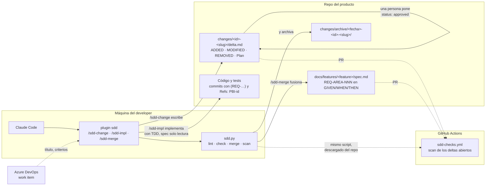
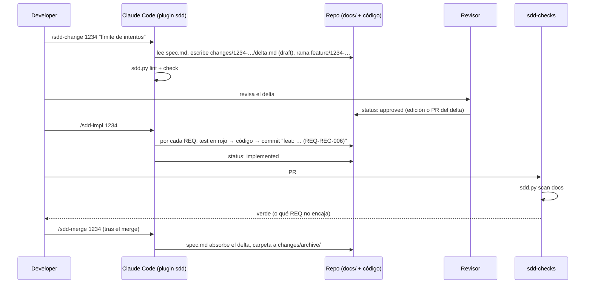

# Sdd-Developer-setup

Spec-Driven Development **mínimo** para equipos que trabajan con Claude Code: un `spec.md` por feature, un `delta.md` por cambio, tres skills y un script de 300 líneas que valida y fusiona. Nace de analizar un setup corporativo con 8 skills de SDD, 7 artefactos por cambio y 12.000 líneas de instalador, y quedarse solo con lo que aporta: requisitos con id estable, el delta como unidad de revisión antes del código, y un check determinista en CI.

- [Cómo encajan las piezas](#cómo-encajan-las-piezas)
- [El ciclo, en cuatro pasos](#el-ciclo-en-cuatro-pasos)
- [Formato de los ficheros](#formato-de-los-ficheros)
- [Las tres skills](#las-tres-skills)
- [El script](#el-script)
- [CI](#ci)
- [Instalación](#instalación)
- [Ejemplo incluido](#ejemplo-incluido)
- [Qué se deja fuera a propósito](#qué-se-deja-fuera-a-propósito)
- [Estructura del repo](#estructura-del-repo)

## Cómo encajan las piezas



Tres piezas y una relación entre ellas:

| Pieza | Dónde vive | Qué hace |
|---|---|---|
| **Los ficheros** (`spec.md`, `delta.md`) | En el repo del producto, bajo `docs/features/` | Son la fuente de verdad. El spec solo lo escribe la fusión; el delta es lo que una persona revisa y aprueba |
| **El plugin** (tres skills + el script) | En la máquina del developer, instalado desde este repo como marketplace de Claude Code | Enseña a Claude a crear el delta, a implementarlo con TDD sin salirse de él y a fusionarlo al cerrar |
| **El workflow** (`sdd-checks.yml`) | En este repo, reutilizable desde cualquier otro con `uses:` | Ejecuta el mismo script contra los deltas abiertos de la PR: formato y que encajan con el spec |

Nada se sincroniza entre repos: el plugin se actualiza con `claude plugin update`, el workflow se referencia por `uses:`, y el único fichero que viaja a cada repo es su propio `docs/`.

## El ciclo, en cuatro pasos



1. **Delta** (`/sdd-change`): a partir del work item o de una descripción, Claude escribe qué requisitos se añaden, cambian o quitan, en GIVEN/WHEN/THEN, y un plan de tests. Queda en `draft`.
2. **Aprobación**: una persona lee el delta, no el código, y pone `status: approved`. Si el equipo quiere la aprobación auditable, el delta va en su propia PR pequeña y CODEOWNERS decide quién puede aprobarla.
3. **Implementación** (`/sdd-impl`): solo con el delta aprobado. Un requisito cada vez, test primero, el id del requisito en el commit. El spec es de solo lectura; si falta algo, se vuelve al delta.
4. **Fusión** (`/sdd-merge`): tras mergear la PR, el spec absorbe el delta, se añade la fila al historial y la carpeta del cambio se archiva. El spec siempre describe lo que hay en `main`.

## Formato de los ficheros

`docs/features/<feature>/spec.md`:

```markdown
---
feature: registro-usuario
title: Registro de usuario con confirmación de email
---
# Registro de usuario con confirmación de email

## Requisitos

### REQ-REG-001 Alta pendiente de confirmación
GIVEN un correo con formato válido que no está registrado
WHEN la persona se registra
THEN existe un usuario en estado pendiente y se le envía un código

## Decisiones

- <decisión y su porqué>

## Historial

| Fecha | PBI | Cambio |
|---|---|---|
| 2026-10-30 | 1000 | Spec inicial |
```

`docs/features/<feature>/changes/<id>-<slug>/delta.md`:

```markdown
---
pbi: 1234
title: Límite de intentos de confirmación
feature: registro-usuario
status: draft | approved | implemented
---
## Por qué
## ADDED        ← requisitos nuevos, con el siguiente número libre del área
## MODIFIED     ← texto completo del requisito tal y como queda
## REMOVED      ← lista "- REQ-REG-003"
## Plan         ← los tests que se escriben primero
```

Reglas que el script comprueba: frontmatter completo, `status` válido, carpeta `<pbi>-<slug>`, las tres secciones presentes, ids `REQ-<AREA>-NNN`, y que `MODIFIED`/`REMOVED` existan en el spec y `ADDED` no.

## Las tres skills

| Skill | Cuándo | Qué hace | Qué no hace |
|---|---|---|---|
| `/sdd-change <id> <descripción>` | Al empezar un PBI o bug | Lee el work item si hay acceso, elige o crea la feature, escribe el delta en `draft`, valida, crea la rama y hace el commit del delta | No escribe código |
| `/sdd-impl [<id>]` | Con el delta en `approved` | TDD requisito a requisito, commits con el REQ, marca el plan, pasa el delta a `implemented` | No toca `spec.md`; no implementa nada fuera del delta |
| `/sdd-merge [<id>]` | Tras mergear la PR | Ejecuta `sdd.py merge`, revisa el spec resultante, commit; opcionalmente cierra el work item | No fusiona un `draft` |

Son tres ficheros `SKILL.md` de 30 a 40 líneas cada uno. No dependen de otras skills ni de agentes.

## El script

`plugins/sdd/scripts/sdd.py`, Python 3 sin dependencias, con tests (`python -I -m unittest discover -s plugins/sdd/scripts/tests`):

| Comando | Qué hace |
|---|---|
| `sdd.py lint <delta.md>` | Formato del delta |
| `sdd.py check <delta.md>` | Que el delta encaja con `spec.md` (dos carpetas arriba) |
| `sdd.py merge <delta.md> [--date YYYY-MM-DD]` | Aplica el delta al spec, añade el historial y archiva la carpeta. Se niega con un `draft` |
| `sdd.py scan [docs]` | `lint` + `check` de todos los deltas abiertos; `archive/` se ignora. Es lo que corre CI |

Sale con 1 si hay problemas y los lista en español, uno por línea, con la ruta del delta.

## CI

En el repo del producto, `.github/workflows/sdd-checks.yml`:

```yaml
name: sdd-checks
on: [pull_request]
jobs:
  sdd:
    uses: goguiGit/Sdd-Developer-setup/.github/workflows/sdd-checks.yml@main
    with:
      docs_root: docs     # opcional
      enforce: true       # false = solo avisa
```

El workflow reutilizable hace checkout del repo llamador y de este, y ejecuta `sdd.py scan`. Como este repo es público, no hace falta copiar el script en cada repo ni vigilar que la copia no se desvíe. Con `enforce: true` la PR falla si un delta abierto tiene mal formato o no encaja con su spec; es el ajuste recomendado desde el primer día, porque un aviso que no bloquea no cambia hábitos.

## Instalación

Requisitos: Claude Code, git y Python 3.

```powershell
git clone https://github.com/goguiGit/Sdd-Developer-setup
.\Sdd-Developer-setup\setup\install.ps1                      # plugin + CLAUDE.md global si no existe
.\Sdd-Developer-setup\setup\install.ps1 -Repo C:\src\MiRepo  # además CLAUDE.md y docs/features en el repo
```

```bash
./Sdd-Developer-setup/setup/install.sh [~/src/mi-repo]
```

El instalador hace dos cosas de Claude Code (`claude plugin marketplace add goguiGit/Sdd-Developer-setup` y `claude plugin install sdd@sdd-developer-setup`) y copia `templates/CLAUDE.md` donde no exista. Actualizar es `claude plugin update sdd@sdd-developer-setup`, o volver a ejecutar el instalador. No hay recibo, ni worktree, ni hooks de deriva: la versión la lleva el gestor de plugins.

## Ejemplo incluido

`docs/features/registro-usuario/` es el registro con confirmación de email de [MassTransit.Saga.Demo](https://github.com/goguiGit/MassTransit.Saga.Demo): un `spec.md` con cinco requisitos y un delta aprobado (`changes/1234-limite-intentos/`) que añade el límite de intentos fallidos y modifica el requisito del código incorrecto. Sirve para probar el ciclo sin inventar nada:

```bash
python -I plugins/sdd/scripts/sdd.py scan docs                                                     # ok
python -I plugins/sdd/scripts/sdd.py merge docs/features/registro-usuario/changes/1234-limite-intentos/delta.md
git diff docs/                                                                                     # el spec con REQ-REG-006 y el delta archivado
git checkout docs/ && git clean -fd docs/                                                          # deshacer la prueba
```

## Qué se deja fuera a propósito

| Fuera | Por qué |
|---|---|
| `mission.md`, `roadmap.md`, `proposal.md`, `design.md`, `spec-index.md` | Se solapan entre sí y con el work item. El "por qué" cabe en el delta; el diseño, si hace falta, es un bloque Mermaid dentro del delta |
| `plan.md` separado | Era una plantilla fija de cinco pasos TDD. El plan real son las casillas del delta |
| Modos de archivado "solo docs" y "solo cierre" | Un solo momento: tras el merge, `/sdd-merge` |
| Sincronización de ficheros entre repos | El plugin se instala, el workflow se referencia. Cada repo solo tiene su `docs/` |
| Instaladores de cientos de líneas, recibo, worktree pinneado, hooks de deriva | Lo hace `claude plugin` |
| Aprobación como campo editable sin control | Si importa, el delta va en su PR con CODEOWNERS |
| Checks en modo aviso | `enforce: true` por defecto |

## Estructura del repo

```
.claude-plugin/marketplace.json     ← este repo es un marketplace de Claude Code con un plugin
plugins/sdd/
  .claude-plugin/plugin.json
  skills/sdd-change/SKILL.md
  skills/sdd-impl/SKILL.md
  skills/sdd-merge/SKILL.md
  scripts/sdd.py                    ← lint, check, merge, scan
  scripts/tests/test_sdd.py
templates/spec.md, delta.md, CLAUDE.md
docs/features/registro-usuario/     ← ejemplo real: spec + delta aprobado
.github/workflows/sdd-checks.yml    ← CI propio y workflow reutilizable
setup/install.ps1, install.sh       ← dos comandos de claude plugin y las plantillas
```
