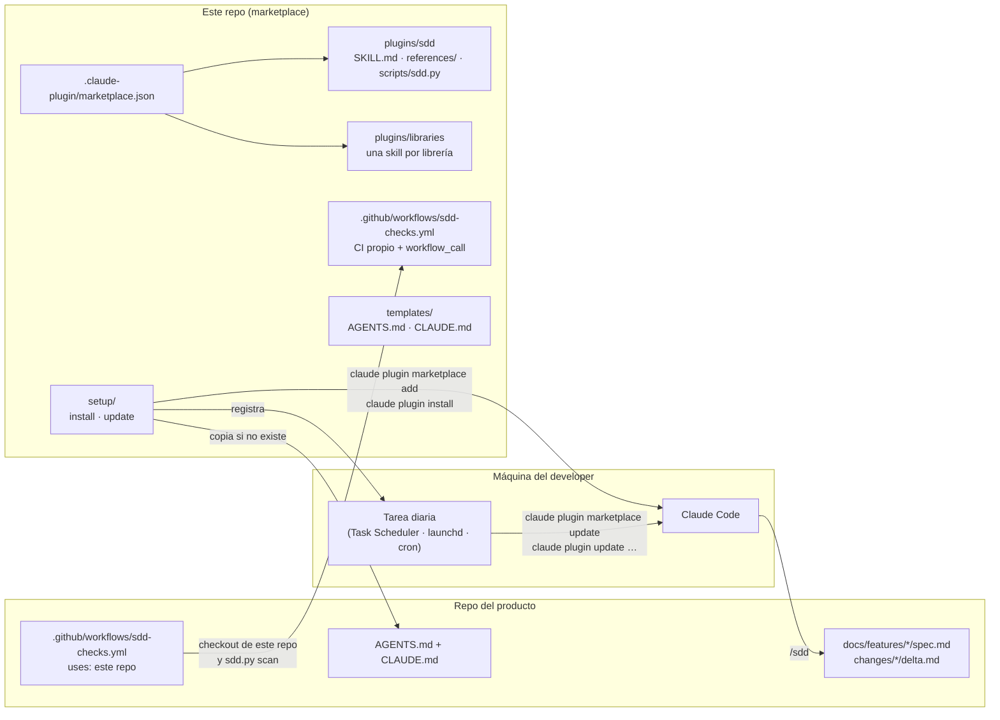

# Implementación

Para quien mantiene este repo o quiere añadirle cosas. El uso está en el [`README.md`](../README.md); lo que se dejó fuera y por qué, en [`decisiones.md`](decisiones.md).

- [Componentes](#componentes)
- [El plugin `sdd`](#el-plugin-sdd)
- [Catálogo de skills](#catálogo-de-skills)
- [El script](#el-script)
- [El workflow de CI](#el-workflow-de-ci)
- [Instalación y actualización](#instalación-y-actualización)
- [MCP del gestor de tareas](#mcp-del-gestor-de-tareas)
- [Versionado](#versionado)
- [Modelos por fase y `sdd.json`](#modelos-por-fase-y-sddjson)
- [Niveles de intervención](#niveles-de-intervención)
- [Añadir una skill de librería](#añadir-una-skill-de-librería)
- [Añadir un plugin nuevo](#añadir-un-plugin-nuevo)
- [Estructura](#estructura)

## Componentes



| Pieza | Qué es | Cambia cuando |
|---|---|---|
| `marketplace.json` | Catálogo: nombre, versión y ruta de cada plugin | Se publica una versión o se añade un plugin |
| `plugins/sdd` | La skill `/sdd`, sus referencias y el script | Cambia el flujo o el formato |
| `plugins/libraries` | Skills de uso de librerías, instalación opcional | Hay una librería nueva o cambia su API |
| `sdd-checks.yml` | CI de este repo y workflow reutilizable | Cambia qué se valida en las PR de los consumidores |
| `templates/` | `AGENTS.md` y `CLAUDE.md` para el repo del producto | Cambian las reglas que todo repo debe conocer |
| `setup/` | Instalador y actualizador | Cambia qué se instala o cómo se programa |

## El plugin `sdd`

`plugins/sdd/skills/sdd/SKILL.md` (~60 líneas) es la skill del flujo; la acompaña `skills/sdd-models/SKILL.md`, con un disparador distinto ("configurar modelos") y sin solapamiento, que solo lee y escribe `sdd.json`. Decide la fase por el `status` del delta: sin delta, lo crea; `draft`, se detiene; `approved`, implementa; `implemented`, fusiona. Lo que necesita leer solo a veces va en `references/`: `format.md` (los dos formatos y qué comprueba el script) y `review-checklist.md` (siete filas para revisar un cambio).

Reglas para tocarla:

- Una skill para el flujo, no una por fase. Otra skill solo con un disparador distinto de verdad: `sdd-models` lo es (configurar la tabla de modelos); "auditar todos los specs" lo sería; "implementar" no.
- Sin nombres de herramientas del host en el texto. La única dependencia es `${CLAUDE_PLUGIN_ROOT}`, que Claude Code define al cargar el plugin, para localizar `scripts/sdd.py`.
- Lo que el script pueda comprobar no se explica en la skill; se le dice que ejecute el script.
- La descripción del frontmatter es lo que Claude usa para decidir cuándo cargarla: debe contener las frases con las que alguien pediría el trabajo.

## Catálogo de skills

La definición de cada skill (disparador, qué hace, qué no, modelo, cómo cambiarlo) vive en [`SKILLS.md`](SKILLS.md) y se actualiza en el mismo commit que la skill. Resumen de lo que decide el modelo:

- Una skill puede fijar `model: <alias>` en su frontmatter (Claude Code también admite `context: fork` y `agent` para ejecutarla en un subagente). Ninguna de las nuestras lo hace a propósito: `sdd` cambia de nivel por fase según `sdd.json` y las demás van con el modelo de la sesión.
- El nivel por fase es configuración del repo del producto (`sdd.json` → `models`), no del plugin, para que cada equipo lo ajuste sin publicar una versión.

## El script

`plugins/sdd/scripts/sdd.py`, Python 3 sin dependencias fuera de la biblioteca estándar, a propósito: CI lo ejecuta con `actions/setup-python` y las skills con el Python del developer. Tests en `scripts/tests/test_sdd.py` (`python -I -m unittest discover -s plugins/sdd/scripts/tests`); cualquier regla nueva del formato entra primero como test.

| Función | Qué hace |
|---|---|
| `lint_delta(texto, carpeta)` | Frontmatter, `status`, carpeta `<pbi>-…`, las tres secciones, ids |
| `check_merge(delta, spec)` | `ADDED` no existe; `MODIFIED` y `REMOVED` existen |
| `merge(delta, spec, fecha)` | Devuelve el spec fusionado con la fila de historial |
| `merge_and_archive(ruta_delta, fecha)` | Rechaza `draft`, escribe el spec, mueve la carpeta a `archive/<fecha>-<id>-<slug>` y regenera los índices |
| `scan(raíz)` | `lint` + `check` de todos los deltas abiertos; ignora `archive/` |
| `build_index(docs)` / `write_index` / `check_index` | Genera `INDEX.md`, `REQ-INDEX.md` y `CONTRACTS.md` en `docs/features/` a partir de los specs y deltas; `check_index` compara con lo escrito y devuelve qué está desactualizado |
| `where(req, docs)` | Bloque del spec, deltas que lo tocan (abiertos y archivados), ficheros de código que lo nombran (`CODE_EXTENSIONS`, saltando `SKIP_DIRS` y `docs/`) y `git log --grep` |

Los índices son deterministas y sin LLM: orden por slug y por id, tablas Markdown, cabecera "Generado por `sdd.py index`; no editar a mano". El recuento de tests de `REQ-INDEX.md` es "ficheros de código fuera de `docs/` que contienen el id": barato y suficiente para ver qué requisito no tiene ningún test. `CONTRACTS.md` solo se escribe si algún requisito lleva `Publica:` o `Consume:`.

Trampa conocida: el bloque de un requisito va desde su `### REQ-…` hasta el siguiente `###` **o** `##`. La primera versión se tragaba `## Decisiones` con el último requisito; está cubierto por `test_decisions_section_is_kept`.

## El workflow de CI

`.github/workflows/sdd-checks.yml` sirve para dos cosas:

- **CI de este repo** (`pull_request`, `push` a `main`): job `script-tests` (los tests del script) y job `deltas` (`sdd.py scan docs` sobre el ejemplo, que debe dar `ok`).
- **`workflow_call`** para los consumidores: solo el job `deltas`. Hace checkout del repo llamador y de este (`actions/checkout` con `repository: goguiGit/Sdd-Developer-setup`, posible porque es público) y ejecuta `scan` y, si existe `docs/features/`, `index --check` sobre `inputs.docs_root`. Con `enforce: true` (por defecto) la PR falla si hay problemas; con `false`, solo anota avisos.

`script-tests` lleva `if: github.event_name != 'workflow_call'` para no ejecutarse en los consumidores.

## Instalación y actualización

`setup/install.ps1` y `setup/install.sh` hacen lo mismo en cada sistema:

1. Comprueban `claude`, `git` y `python`.
2. `claude plugin marketplace add goguiGit/Sdd-Developer-setup` si no está; `claude plugin install sdd@sdd-developer-setup --scope user` o `update` si ya está.
3. Con `-Repo` / argumento: copian `templates/AGENTS.md`, `templates/CLAUDE.md` y `templates/sdd.json` al repo si no existen y crean `docs/features/`.
4. Con `-Tracker` / `TRACKER`: registran el MCP del gestor de tareas a nivel de usuario si no está (ver [MCP del gestor de tareas](#mcp-del-gestor-de-tareas)).
5. Registran la actualización diaria (hora por `-UpdateAt` / `UPDATE_AT`, 08:00 por defecto): tarea del Programador de tareas en Windows (`StartWhenAvailable`), LaunchAgent `com.sdd.plugin-update` en macOS (`StartCalendarInterval`), línea de `crontab` marcada `# claude-sdd-plugin-update` en Linux. Idempotentes: reemplazan, no duplican. `-RemoveSchedule` / `--remove-schedule` la quitan.

`setup/update.ps1` y `update.sh` son lo que la tarea ejecuta: `claude plugin marketplace update sdd-developer-setup` y después `claude plugin update` **de cada plugin instalado desde este marketplace** (`sdd`, `libraries`, los que haya), con log en `~/.claude/sdd-update.log` y salida 1 si Claude devolvió un fallo. En macOS y Linux la tarea graba el `PATH` del momento de instalar porque launchd y cron arrancan con uno mínimo.

## MCP del gestor de tareas

El plugin no declara MCP propios (un `.mcp.json` en el plugin obligaría a todos a la misma organización de Azure DevOps o al mismo Jira). El MCP lo registra el instalador a nivel de usuario, por parámetro:

| Parámetro | Registra | Autenticación |
|---|---|---|
| `-Tracker AzureDevOps -Organization <org>` / `TRACKER=AzureDevOps ADO_ORG=<org>` | `claude mcp add --scope user azure-devops -- npx -y @azure-devops/mcp <org>` (MCP oficial de Microsoft) | Sesión de `az login` |
| `-Tracker Jira` / `TRACKER=Jira` | `claude mcp add --transport sse --scope user atlassian https://mcp.atlassian.com/v1/sse` (MCP remoto de Atlassian) | OAuth en el navegador la primera vez |

La skill no nombra herramientas concretas del MCP: describe operaciones (leer ticket, crear tareas hijas, actualizar criterios y estado) en `references/trackers.md` y deja que el agente use las que el servidor exponga (`claude mcp list`). Así un cambio de versión del MCP no rompe la skill. Para añadir otro gestor: una sección en `trackers.md` con el comando de registro y el mapeo de operaciones, y la rama correspondiente en los dos instaladores.

## Versionado

Cada plugin tiene su versión en dos sitios que deben coincidir: `plugins/<plugin>/.claude-plugin/plugin.json` y su entrada en `.claude-plugin/marketplace.json`. Subirla en los dos y hacer merge a `main` es publicar: la tarea diaria de cada developer hace `marketplace update` + `plugin update` y recoge la nueva. Convención: `MAJOR` si cambia el formato de `spec.md` o `delta.md` (los repos tienen que migrar sus docs), `MINOR` si cambia la skill o se añade una skill de librería, `PATCH` para correcciones de texto o del script sin cambio de formato.

## Modelos por fase y `sdd.json`

`plugins/sdd/skills/sdd/references/models.md` es la política: niveles (máximo, medio, rápido) con alias del host, tabla por defecto por fase, criterios de subida y bajada automáticas, y el formato de `sdd.json`. La skill la lee al empezar y aplica el nivel cuando delega una fase a un subagente (implementación, revisión); en la sesión principal solo lo recomienda, porque el modelo de la sesión lo elige quien la abre.

`/sdd-models` (`show`, `recommend`, `set`, `reset`) es la forma de ver y cambiar la tabla sin editar el JSON; `recommend` compara los alias configurados con los que el host ofrece y lo que el historial reciente sugiere, y propone sin cambiar. `sdd.json` (plantilla en `templates/sdd.json`, copiada por el instalador con `-Repo` si no existe) tiene cuatro claves: `selfService` (rutas glob que alguien sin perfil técnico puede cambiar sin developer cuando no hay cambio de requisitos; vacía por defecto), `models` (alias por fase: `change`, `impl`, `review`, `merge`), `tracker` (`AzureDevOps`, `Jira`, `None`) y `createTasks` (`true`, `false`, `"never"`). Lo lee la skill, no el script: `sdd.py` no sabe de modelos ni de gestores, a propósito, para que siga siendo stdlib y determinista.

Por qué alias y no ids: los ids de modelo llevan fecha y caducan; un alias de nivel sigue apuntando al modelo actual cuando el proveedor publica uno nuevo, y cambiar de nivel en todo el equipo es editar una línea del `sdd.json`. Cuando el host añada un nivel nuevo, basta con usar su alias; `models.md` no necesita cambiar.

`examples/happy-path/` es la narración de un PBI completo con esta política aplicada; si cambia el flujo, se actualiza ese ejemplo en el mismo commit.

## Niveles de intervención

La skill clasifica cada petición antes de actuar (sección "Quién pide y cuánta intervención hace falta" de `SKILL.md`): nivel 0 (sin cambio de requisitos y solo rutas `selfService`: sin developer, PR etiquetada `self-service`), nivel 1 (cambio de requisitos: un developer aprueba el delta y revisa) y nivel 2 (contratos, persistencia, autorización, pagos, datos personales o más de tres requisitos: developer en delta y PR, revisión al nivel máximo). Los criterios de nivel 2 son los mismos que suben el modelo al máximo en `models.md`, a propósito: una sola lista de "esto es delicado". Nada se auto-mergea; el CI y una revisión humana siguen siendo el gate. Para cambiar la clasificación, se cambia la tabla de `SKILL.md` y este párrafo, no se añade lógica al script.

## Añadir una skill de librería

Las skills de librerías van en `plugins/libraries/skills/<nombre>/`, una carpeta por librería, y se instalan con `claude plugin install libraries@sdd-developer-setup`. Para añadir una:

1. Carpeta `plugins/libraries/skills/<area>-<libreria>/` con `SKILL.md`. Nombre en minúsculas con guiones: `cache-redis`, `messaging-masstransit`, `feature-flags`.
2. Frontmatter con `name` y una `description` que diga **cuándo** cargarla, con las frases que alguien usaría ("cachear una consulta", "invalidar la caché") y los tipos clave de la librería. Es lo único que el agente lee para decidir.
3. Cuerpo de 30 a 60 líneas: qué hace la librería en una frase, cómo se registra, el uso habitual con un ejemplo de código corto, las trampas (lo que parece correcto y no lo es) y qué **no** hacer. Lo largo (tablas de opciones, varios ejemplos) va en `references/` y se enlaza.
4. Si la librería tiene un repo de ejemplo o documentación propia, enlázalos en vez de copiar.
5. Sube la versión `MINOR` de `plugins/libraries` en sus dos sitios y abre PR. El CI de este repo valida los manifiestos con `claude plugin validate`.

La primera, `masstransit-saga`, sirve de modelo.

Qué no hacer: no meter en la skill reglas del flujo SDD (eso está en `sdd`), no duplicar la documentación oficial de la librería, no crear una skill para una librería que el agente ya usa bien sin ayuda.

## Añadir un plugin nuevo

Cuando un conjunto de skills tiene un público distinto (por ejemplo, skills de frontend que los developers de backend no quieren), va en su propio plugin: carpeta `plugins/<nombre>/` con `.claude-plugin/plugin.json`, `skills/`, y una entrada nueva en `marketplace.json`. La tarea diaria lo actualiza igual que a los demás; se instala solo donde haga falta.

## Estructura

```
.claude-plugin/marketplace.json           ← catálogo de plugins de este repo
plugins/sdd/
  .claude-plugin/plugin.json
  skills/sdd/SKILL.md                     ← la skill; decide la fase por el status del delta
  skills/sdd/references/format.md         ← formato de spec.md y delta.md, y qué comprueba el script
  skills/sdd/references/review-checklist.md
  skills/sdd/references/trackers.md       ← qué hace la skill con Azure DevOps o Jira, y cómo registrar su MCP
  skills/sdd/references/models.md         ← niveles de modelo por fase, criterios de cambio, formato de sdd.json
  skills/sdd/references/principles.md     ← principios independientes del lenguaje, con su señal de ruptura
  skills/sdd-models/SKILL.md              ← ver, recomendar o cambiar la tabla de modelos en sdd.json
  scripts/sdd.py, scripts/tests/          ← lint, check, merge, scan
plugins/libraries/
  .claude-plugin/plugin.json
  skills/masstransit-saga/SKILL.md        ← modelo de skill de librería
templates/AGENTS.md, CLAUDE.md, sdd.json  ← para el repo del producto (CLAUDE.md es "@AGENTS.md"; sdd.json: modelos, gestor, tareas)
examples/happy-path/                      ← un PBI narrado de principio a fin, con tareas y modelo por fase
docs/features/registro-usuario/           ← ejemplo real y fixture del CI: spec + delta aprobado
docs/IMPLEMENTACION.md, decisiones.md
.github/workflows/sdd-checks.yml          ← CI propio y workflow reutilizable
setup/install.*, update.*                 ← plugin, plantillas y la tarea diaria de actualización
```
