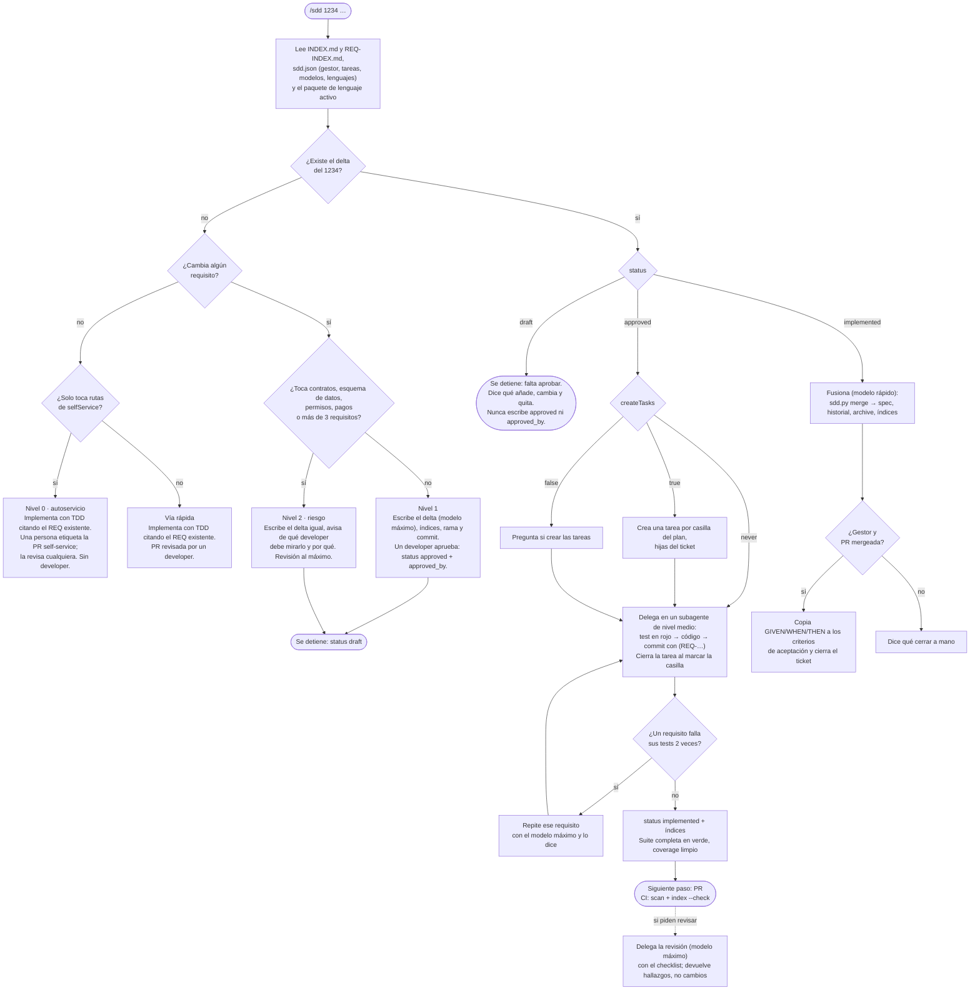

# Ejemplo: el camino feliz, de principio a fin

Un PBI real del servicio de registro, desde que llega hasta que el spec lo absorbe, con lo que escribe la persona, lo que hace el agente, qué ficheros cambian, qué tareas aparecen en el gestor y qué modelo se usa en cada fase. El repo de ejemplo es [MassTransit.Saga.Demo](https://github.com/goguiGit/MassTransit.Saga.Demo) (C#), cuyo spec está en [`docs/features/registro-usuario/`](../../docs/features/registro-usuario/spec.md); el gestor es Azure DevOps conectado por MCP, y el `sdd.json` del repo es [este](sdd.json): paquete de lenguaje `csharp`, tareas automáticas, autoservicio abierto en `docs/**`, `**/*.resx` y `**/locales/**/*.json`.

## Qué decide el agente, y cuándo

Cada vez que alguien escribe `/sdd <id>`, el agente recorre este árbol. No hay que recordar en qué paso se está: lo lee del estado del delta y lo dice.



Tres cosas que el diagrama deja a la vista:

- **Dónde se detiene el agente** (los nodos redondeados): al dejar un delta en `draft` y al encontrarse uno sin aprobar. Entre medias no hay código. Es el gate que hace que una persona decida qué se construye, y por eso `approved_by` lo escribe esa persona y nunca el agente.
- **Qué necesita un developer y qué no**: solo el nivel 0 prescinde de él, y solo porque no cambia ningún requisito y toca rutas que el equipo abrió a propósito. La vía rápida ahorra el delta, no la revisión.
- **Qué modelo trabaja en cada tramo**: máximo donde se decide (delta, revisión), medio donde se ejecuta con tests detrás, rápido donde solo se corre un script. Y el único caso en que el agente sube solo: dos fallos seguidos en el mismo requisito.

## Punto de partida

- PBI **1234** en Azure DevOps, estado *Approved*: "Límite de intentos al confirmar el email. Hoy un código incorrecto no tiene consecuencias; con seis dígitos y 24 h se puede probar por fuerza bruta. Criterio: tras el quinto fallo el registro se descarta y se avisa".
- `docs/features/registro-usuario/spec.md` con cinco requisitos, `REQ-REG-001` a `REQ-REG-005`.
- `docs/features/INDEX.md` y `REQ-INDEX.md` al día; `sdd.json` con `"languages": ["csharp"]`.

## Paso 1. Crear el delta

**La persona escribe**, en Claude Code dentro del repo:

```
/sdd 1234 límite de intentos al confirmar el email
```

**El agente** (nivel máximo, porque va a decidir requisitos):

1. Lee `INDEX.md`: una feature, `registro-usuario`, sin deltas abiertos. Abre solo ese spec.
2. Lee el PBI 1234 por el MCP de Azure DevOps: título, descripción, criterios de aceptación. Lo pasa a *In Progress* y se lo asigna.
3. Clasifica: modifica un requisito y añade otro, sin contratos ni esquema de datos. **Nivel 1**; lo dice.
4. Escribe `docs/features/registro-usuario/changes/1234-limite-intentos/delta.md` en `status: draft`: por qué (fuerza bruta), `ADDED` con `REQ-REG-006 Límite de intentos fallidos`, `MODIFIED` con el texto nuevo completo de `REQ-REG-003 Código incorrecto` (ahora cuenta el intento), `REMOVED` vacío, y un plan de cuatro casillas.
5. `sdd.py lint` y `check`: ok. `sdd.py index`: `INDEX.md` gana la fila del delta abierto.
6. Rama `feature/1234-limite-intentos`, commit `docs: delta del PBI 1234, límite de intentos de confirmación` con el delta y los índices, trailer `Refs: PBI-1234`.

**Resumen que devuelve**: "Nivel 1. Delta en draft: añade REQ-REG-006, modifica REQ-REG-003, no quita nada. Para implementar, un developer tiene que poner `status: approved` y su nombre en `approved_by`. Usé el nivel máximo para escribirlo porque modifica un requisito existente."

Nada de código todavía.

## Paso 2. Aprobar

Otra persona del equipo lee el delta (doce líneas de requisitos), cambia `status: draft` por `status: approved` y añade `approved_by: ana`, o aprueba la PR que solo contiene el delta si el equipo trabaja así. Si quisiera cambiar el umbral de cinco a tres intentos, lo dice ahora y el agente reescribe el delta; es barato cambiarlo aquí y caro después.

## Paso 3. Implementar, con tareas en el gestor

**La persona escribe**:

```
/sdd 1234
```

**El agente** lee el delta: `approved`, con `approved_by`. Lee `sdd.json`: `"tracker": "AzureDevOps"`, `"createTasks": true`, `"impl": "sonnet"`, `"languages": ["csharp"]`. Lee el paquete `csharp`: el requisito se cita con `// REQ-REG-006` encima del test, los tests van con `dotnet test`.

1. **Crea las tareas** en Azure DevOps, una por casilla del plan, hijas del PBI 1234, y lo dice:

   | Tarea creada | Texto |
   |---|---|
   | 1234-1 | Test: el quinto código incorrecto publica `RegistrationDiscarded` (REQ-REG-006) |
   | 1234-2 | Test: el cuarto código incorrecto deja la saga en `AwaitingConfirmation` con `FailedAttempts = 4` (REQ-REG-003) |
   | 1234-3 | `RegistrationState.FailedAttempts` y `Reject()` en el dominio |
   | 1234-4 | La rama `Ignore` de `EmailConfirmed` pasa a `When` que cuenta y decide |

   Con `"createTasks": false` habría preguntado antes; con `"never"`, no las crea.

2. **Delega la implementación en un subagente de nivel medio** (`sonnet`) con el delta, el spec, el paquete `csharp` y `principles.md` como contexto, requisito a requisito:
   - `REQ-REG-006`: test `RegistrationStateMachine_FifthWrongCode_DiscardsRegistration` con `// REQ-REG-006` en rojo → `FailedAttempts` en `RegistrationState`, `Reject()` → verde → commit `feat: discard the registration after five wrong codes (REQ-REG-006)` con `Refs: PBI-1234`. Cierra las tareas 1234-1 y 1234-3.
   - `REQ-REG-003`: cambia el test existente al nuevo GIVEN/WHEN/THEN, lo ve fallar, cambia el `Ignore` por un `When` que incrementa → commit `feat: count failed confirmation attempts (REQ-REG-003)`. Cierra 1234-2 y 1234-4.
3. Suite completa en verde (30 tests de la demo más los dos nuevos). `sdd.py coverage` no lista ni `REQ-REG-006` ni `REQ-REG-003`.
4. Marca las casillas del plan, `status: implemented`, `sdd.py index` (`INDEX.md` cambia el estado del delta), commit `docs: PBI 1234 implementado`.

**Resumen**: "Dos requisitos implementados en cuatro commits, 32 tests en verde, cuatro tareas cerradas en Azure DevOps. Implementación delegada con nivel medio; no hizo falta subir porque ningún test falló dos veces. Siguiente paso: PR."

Si durante la implementación un test hubiera fallado dos veces seguidas, el agente habría repetido ese requisito con el nivel máximo y lo habría dicho en el resumen. Si el host no le hubiera dejado elegir el modelo del subagente, habría implementado en la sesión y lo habría dicho igual.

## Paso 4. PR y revisión

La persona abre la PR. El CI ejecuta `sdd.py scan` (el delta encaja con el spec y tiene `approved_by`) e `index --check` (los índices van regenerados en los commits que tocaron `docs/features/`). El revisor aplica las ocho filas del [checklist](../../plugins/sdd/skills/sdd/references/review-checklist.md). Si quiere una segunda opinión antes, escribe `/sdd review 1234`: el agente delega la revisión en un subagente de nivel máximo con el diff, el delta y el checklist, y devuelve hallazgos citando la fila o el principio, sin tocar código.

## Paso 5. Fusionar

Tras el merge, la persona escribe:

```
/sdd 1234
```

**El agente** lee el delta: `implemented`. Nivel rápido: solo ejecuta el script y lee su salida.

1. `sdd.py merge`: `REQ-REG-006` entra en el spec antes de `## Decisiones`, `REQ-REG-003` queda con el texto nuevo, fila `| 2026-11-02 | 1234 | Límite de intentos de confirmación |` en el historial, carpeta movida a `changes/archive/2026-11-02-1234-limite-intentos/`, índices regenerados (`REQ-INDEX.md` gana una línea, `INDEX.md` pierde el delta abierto).
2. Relee el spec: numeración correcta, la decisión "la saga decide si el código es correcto" sigue siendo cierta.
3. Commit `docs: fusiona el PBI 1234 en el spec de registro-usuario`, `Refs: PBI-1234`.
4. Como se lo piden, copia los GIVEN/WHEN/THEN de `ADDED` y `MODIFIED` a los criterios de aceptación del PBI 1234 y lo pasa a *Done*.

## Qué quedó

```
docs/features/registro-usuario/spec.md                                   ← 6 requisitos, historial con el 1234
docs/features/registro-usuario/changes/archive/2026-11-02-1234-limite-intentos/delta.md
docs/features/INDEX.md, REQ-INDEX.md, CONTRACTS.md                       ← regenerados
src/… y tests/…                                                          ← 4 commits con (REQ-REG-006) y (REQ-REG-003)
Azure DevOps                                                             ← PBI 1234 Done, 4 tareas cerradas, criterios de aceptación = los requisitos
```

Y `python3 <clon>/plugins/sdd/scripts/sdd.py where REQ-REG-006` lo enseña todo junto: el bloque del spec, el delta archivado, los dos ficheros de test y los commits.

## Otro camino: lo pide Producto, sin developer

Una semana después, la persona de producto quiere que el correo de bienvenida salude por el nombre. No sabe de código y no tiene por qué.

1. **Producto escribe**: `/sdd 1250 que el correo de bienvenida diga "Hola, <nombre>" en vez de "Bienvenida"`.
2. **El agente clasifica**: ¿cambia algún requisito? Lee `REQ-REG-002` ("… se envía el correo de bienvenida"); sigue siendo cierto con el texto nuevo. No hay delta. ¿Solo toca rutas de `selfService`? El texto vive en `src/Api/Resources/Welcome.resx`, que encaja en `**/*.resx`. **Nivel 0**, y lo dice: "autoservicio; no hace falta developer".
3. Implementa en la vía rápida: ajusta el test de la bienvenida (sigue citando `REQ-REG-002`), cambia el recurso, suite en verde, commit `fix: greet the user by name in the welcome email (REQ-REG-002)`. `sdd.py selfservice` sobre los ficheros tocados: ninguno fuera de `selfService`.
4. Abre la PR y dice: "puede llevar la etiqueta `self-service`; la puede revisar cualquiera del equipo, incluida tú". **Producto pone la etiqueta** (el agente no la pone). El CI pasa `scan` e `index --check` y, al ver la etiqueta, compara el diff con `selfService`: sin avisos.
5. Una compañera de soporte revisa el texto, aprueba, merge. Ningún developer ha intervenido.

Si Producto hubiera pedido "que el código tenga ocho dígitos", `REQ-REG-001` dejaría de ser cierto: el agente habría escrito el delta igual de claro y habría dicho "nivel 1, un developer tiene que aprobar este delta". Y si al cambiar el texto hubiera tenido que tocar un fichero `.cs`, habría dicho que deja de ser nivel 0 y que la PR necesita un developer.

## Variantes del mismo camino

- **Sin gestor** (`"tracker": "None"`): el agente pregunta por el PBI una vez, no crea tareas y al final dice qué cerrar a mano.
- **Sin cambio de requisitos ni autoservicio** (un bug en la lógica de caducidad): no hay delta; `/sdd 1300 la caducidad cuenta mal las 24 horas` implementa con TDD citando `REQ-REG-004` en el commit, y la PR la revisa un developer. Nivel rápido si el cambio es trivial.
- **El ticket cambia a mitad**: el delta vuelve a `draft` (y pierde `approved_by`), se reescribe y se vuelve a aprobar. Las tareas ya creadas se actualizan o se cierran como descartadas, y se dice cuáles.
- **Repo en otro lenguaje**: con `"languages": ["typescript"]` el test se llamaría `it('discards the registration after the fifth wrong code (REQ-REG-006)')` y los tests correrían con `npm test`; el resto del camino es idéntico.
